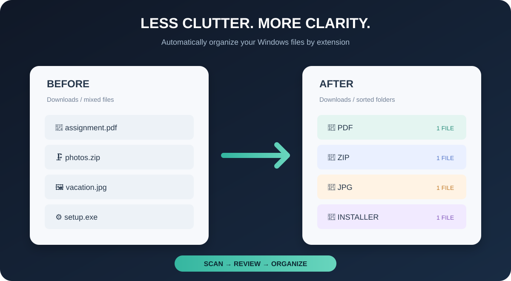

<div align="center">

# Desktop File Sorter

### Less clutter. More clarity.

A simple Windows desktop app that organizes files into folders by extension.

[](https://www.python.org/)
[](https://www.microsoft.com/windows)
[](https://docs.python.org/3/library/tkinter.html)
[](LICENSE)

**Languages:** English | [Bahasa Indonesia](README.id.md)

</div>

---


## Live Demo

See the application in action in the **demo video attached to GitHub Issue #1**.

<p align="center">
  <a href="https://github.com/Bagaas-ind/desktop-file-sorter/issues/1">
    
  </a>
</p>

<p align="center">
  <a href="https://github.com/Bagaas-ind/desktop-file-sorter/issues/1"><strong>▶ WATCH THE DEMO VIDEO · OPEN ISSUE #1</strong></a>
</p>

The visual above explains the core workflow: mixed files are scanned, reviewed, and moved into folders based on their extensions. **Click the demo banner or the button to watch the recorded application demo.**

## Overview

Desktop File Sorter helps you clean up a folder without manually moving every file. It scans the folder you select, shows a preview of the planned destinations, and moves files into folders based on their extensions after you confirm.

```text
 BEFORE                                  AFTER
 Downloads/                              Downloads/
 ├── assignment.pdf                      ├── PDF/
 ├── photos.zip              ───────▶    │   └── assignment.pdf
 ├── vacation.jpg                        ├── ZIP/
 └── installer.exe                       │   └── photos.zip
                                         ├── JPG/
                                         │   └── vacation.jpg
                                         └── INSTALLER/
                                             └── installer.exe
```

**Workflow:** Choose a folder → Scan → Review → Organize.

## Features

- **Choose your folder** — use Downloads by default or select another folder.
- **Preview before organizing** — review detected files and their destination folders.
- **Automatic sorting** — group files by extension, such as PDF, ZIP, JPG, DOCX, MP4, and more.
- **Installer grouping** — supported installer packages are placed in `INSTALLER/`.
- **Filename collision protection** — existing files are not overwritten; a number is added to duplicate filenames, such as `report (1).pdf`.
- **Operation history** — review previous sorting operations.
- **Undo** — move files back to their original locations when those locations are available.
- **Local operation** — file organization happens on your computer; no account or online service is required.

## Application Sections

| Section | Purpose |
| --- | --- |
| **Dashboard** | Shows the selected folder and a summary of files and categories. |
| **Organize Files** | Scans files, displays the preview, and starts sorting after confirmation. |
| **History** | Reviews previous operations and provides Undo. |
| **Settings** | Changes the target folder and confirmation preference. |
| **About** | Displays application information. |

## Requirements

- Windows 10 or Windows 11.
- Python 3.12 or newer recommended.
- Tkinter, normally included with the standard Windows Python installer.
- Git, if you want to clone the repository from the terminal.

> You do not need a GitHub account to clone this public repository. Git is only needed for the Git Clone method. You can also download the project as a ZIP file.

## Installation and Launch

Choose **one** of the following methods.

### Method 1 — Clone with Git

1. Install Python from [python.org](https://www.python.org/downloads/windows/). During installation, enable **Add Python to PATH**.
2. Install Git from [git-scm.com](https://git-scm.com/download/win).
3. Open PowerShell or Command Prompt.
4. Run these commands:

```powershell
git clone https://github.com/Bagaas-ind/desktop-file-sorter.git
cd desktop-file-sorter
python main.py
```

### Method 2 — Download ZIP

1. Open the [Desktop File Sorter repository](https://github.com/Bagaas-ind/desktop-file-sorter).
2. Click **Code → Download ZIP**.
3. Extract the downloaded ZIP file.
4. Open the extracted `desktop-file-sorter` folder.
5. Open PowerShell or Command Prompt in that folder (the folder containing `main.py`).
6. Run:

```powershell
python main.py
```

### Do I need to install Python packages?

The application itself uses Python's standard library, including Tkinter. You normally do **not** need to install additional packages just to launch it.

The repository's `requirements.txt` lists optional development/build tools. Install them only if you need them:

```powershell
python -m pip install -r requirements.txt
```

## First Run and Usage

1. Launch the app using `python main.py`.
2. Open **Settings** and check the target folder. The default is the current Windows user's Downloads folder.
3. To organize another folder, click **Browse**, select the folder, and save the settings.
4. Open **Organize Files** and click **Scan Ulang**.
5. Review the files and their planned destination folders.
6. Click **RAPIKAN DOWNLOADS SEKARANG** and confirm the operation.
7. Open **History** to review the operation or use **Undo** when you want to restore files.

### Important: it organizes the selected folder

The app scans files directly inside the selected folder. It does not scan the contents of subfolders recursively. It skips folders, symbolic links, hidden dotfiles, and certain app metadata files.

### Where are settings and history stored?

On Windows, application settings and operation history are stored locally under:

```text
%APPDATA%\DesktopFileSorter\
```

This data is stored separately for each Windows user account.

## Safety Notes and Limitations

File organization moves files from their current location into category folders. Please read these notes before using it on important folders:

- **Test first.** Try the app with a temporary folder containing copies of a few files.
- **Review before confirming.** Check the preview and confirmation dialog before moving files.
- **No intentional deletion.** The organizer moves files; it is not designed to delete them.
- **Name conflicts.** If a destination file already exists, the app adds a number to the new filename instead of overwriting the existing file.
- **Undo limitation.** Undo cannot restore a file if its original path is already occupied by another file. Review any error messages if some files cannot be restored.
- **Keep backups.** Maintain a separate backup of important data. Undo is not a replacement for a backup.
- **Do not interrupt an operation.** Avoid closing the app or shutting down Windows while files are being moved.

## Testing

Run the test suite from the project folder:

```powershell
python -m unittest discover -s tests -v
```

## Build a Windows Executable (Optional)

If you want to package the application into an executable, install PyInstaller:

```powershell
python -m pip install pyinstaller
```

Then run:

```powershell
pyinstaller --noconfirm --clean --onefile --windowed --name DesktopFileSorter main.py
```

The executable will be created in:

```text
dist/DesktopFileSorter.exe
```

This is a build instruction for users/developers who want to create their own executable. A prebuilt `.exe` is only available if the repository owner publishes one in **Releases**.

## Troubleshooting

| Problem | What to try |
| --- | --- |
| `python` is not recognized | Reinstall Python and enable **Add Python to PATH**, or try `py main.py`. |
| `git` is not recognized | Install Git, reopen the terminal, and try again. |
| `can't open file 'main.py'` | Change directory to the extracted/cloned project folder that contains `main.py`. |
| The app does not open | Confirm that Python is installed correctly and that Tkinter is available. |
| Some files are not moved | Check file permissions, whether the file is in use, and the error message shown by the app. |

## Technology

- [Python](https://www.python.org/)
- [Tkinter](https://docs.python.org/3/library/tkinter.html)
- pathlib and shutil
- JSON for local settings and history

## Contributing

Contributions are welcome.

1. Fork this repository.
2. Create a branch for your change.
3. Make and test your changes.
4. Submit a Pull Request with a clear description.

For bugs or feature ideas, open a [GitHub Issue](https://github.com/Bagaas-ind/desktop-file-sorter/issues).

## License

This project is licensed under the **MIT License**. You may use, copy, modify, merge, publish, distribute, sublicense, and sell copies of the software, subject to the conditions in the [LICENSE](LICENSE) file.

## Support

If this project is useful to you, consider giving the repository a ⭐ Star. It helps others discover Desktop File Sorter.

---

<div align="center">

**Desktop File Sorter**  
*Less clutter. More clarity.*  
Created by [Bagaas-ind](https://github.com/Bagaas-ind)

</div>
